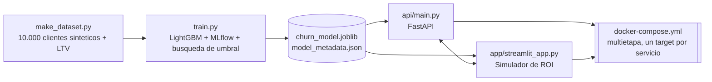

[ 🇨🇱 Español ] | [ 🇺🇸 Read in English ](README.md)

# Plataforma MLOps de Predicción y Retención de Churn de Clientes


Sistema end-to-end de predicción de fuga de clientes para banca/retail, diseñado alrededor de una idea central: **un modelo de churn no vale por su AUC, vale por cuánto dinero deja de perder la empresa cuando se usa para decidir a quién contactar.**

## Impacto de Negocio e Indicadores Clave (KPIs)

Entrenado con **10.000 clientes bancarios reales** (Kaggle "Bank Customer Churn", Francia / Alemania / España, churn 20,4%) y evaluado en un holdout de 2.000 clientes nunca visto durante el entrenamiento ni la selección de umbral. El valor se mide contra no hacer ninguna campaña (que pierde $1,15 millones de LTV de churners en el holdout):

| Estrategia | LTV recuperado, neto del costo de campaña | Clientes contactados |
|---|---:|---:|
| No contactar a nadie | $0 | 0% |
| Contactar a todos (sin modelo) | +$143.842 | 100% |
| **Umbral del modelo (0,24, elegido en validación)** | **+$189.930** | 41,7% |

El modelo recupera 32% más que una campaña indiscriminada contactando a menos de la mitad de los clientes. El costo de la oferta ($100), la tasa de retención (30%) y el LTV son supuestos de negocio, porque el dataset real trae la fuga pero no los ingresos; están documentados en `src/data/make_dataset.py` y `src/models/train.py`.

Dos hallazgos del paso a datos reales:

- **La columna `Complain` es una filtración.** 2.034 de los 2.038 churners tienen una queja, contra 10 de los 7.962 que se quedaron: la queja se registra junto con la salida. Con ella, LightGBM llega a ROC-AUC 1,000; sin ella, **0,852**. Se conserva en los datos y se excluye de las features, y `train.py` registra ambos números en cada corrida.
- **El objetivo financiero anterior contaba doble.** Le abonaba a cada churner contactado el 30% de su LTV pero nunca le cargaba el 70% que se va igual, así que cada contacto valía 1,3 × LTV en vez de 0,3 × LTV. Eso empujaba el umbral "óptimo" a 0,03 (contactar al 90% de los clientes). Corregido, el punto de equilibrio es `p_churn = costo / (tasa_de_éxito × LTV)`, unos 0,12 para un cliente típico, y el umbral queda en 0,24.

## Arquitectura



```
┌────────────────────────┐
│  make_dataset.py        │  10.000 clientes reales (Kaggle) + LTV supuesto
└────────────┬─────────────┘
             │
             ▼
┌────────────────────────┐
│       train.py           │  LightGBM + split 50/30/20 + MLflow (tracking +
│  (MLflow: SQLite local)  │  registry) + búsqueda de umbral por retorno ($)
└────────────┬─────────────┘
             │
    ┌────────┴─────────┐
    │  data/processed/   │  churn_model.joblib + model_metadata.json
    └────────┬─────────┘
             │
   ┌─────────┴──────────┐
   ▼                     ▼
┌─────────────┐   ┌──────────────────┐
│  api/main.py │◄──┤ app/streamlit_app │  Simulador de ROI (recalcula el umbral
│  (FastAPI)   │   │  .py              │  en vivo) + predicción individual (vía API)
└─────────────┘   └──────────────────┘
       │                    │
       └─────────┬──────────┘
                  ▼
        docker-compose.yml
   (Dockerfile multietapa, un target por servicio)
```

`notebooks/02_LTV_Cost_Sensitive_Thresholding.ipynb` corre en paralelo a este pipeline, consumiendo directamente el modelo entrenado y `src/models/train.py` para profundizar en la distribución de LTV del holdout y la curva de ganancia (§Fase 4).

## El proceso (las 4 fases)

Este proyecto se construyó en fases, entregadas y verificadas una por una — no se escribió todo de una vez y se asumió que funcionaba.

### Fase 1 — Datos y modelado

`src/data/make_dataset.py` carga el dataset real de Kaggle ([Bank Customer Churn](https://www.kaggle.com/datasets/radheshyamkollipara/bank-customer-churn), descargado con la API de Kaggle a `data/raw/`, que está en el gitignore) y lo lleva al esquema del proyecto: score crediticio, país, género, edad, antigüedad, balance, productos, tarjeta, actividad, salario, satisfacción, tipo de tarjeta, puntos de fidelización y el indicador real de salida. Lo que los datos no traen son los ingresos, así que `monthly_fee_revenue` (15 + 8 × productos + 0,0008 × balance) y el **LTV proyectado** (ingreso mensual × meses futuros esperados, 48 si está activo y 18 si no) son supuestos explícitos, usados solo para el valor financiero y nunca como features. El generador sintético original queda como respaldo con el mismo esquema, para correr la CI sin credenciales de Kaggle.

`src/models/train.py` entrena LightGBM sobre un split estratificado 50/30/20 (train / val / test), trackea todo en MLflow (SQLite local, con Model Registry funcionando), y busca el **umbral de decisión que maximiza el retorno financiero neto** en validación, no el que maximiza F1 o accuracy. El objetivo, por cliente: un churner no contactado pierde su LTV; uno contactado se retiene con probabilidad `tasa_de_éxito` y si no se pierde igual; cada contacto cuesta el precio de la campaña. Las features excluyen el ID, los supuestos de LTV e ingreso, y `num_complaints` (la filtración de arriba); la misma corrida entrena una copia con la filtración y registra sus métricas, para que la inflación quede a la vista.

Métricas de test: ROC-AUC 0,852, PR-AUC 0,687. Umbral 0,24 en validación; recalculado sobre test (solo diagnóstico) sería 0,19, y la curva es tan plana ahí que la diferencia cuesta $6.300 (0,7%).

### Fase 2 — API y UI

`src/api/main.py`: FastAPI + Pydantic v2, con `lifespan` (no el `on_event` deprecado) para cargar el modelo al arrancar. Antes de escribirla verifiqué empíricamente un detalle no obvio de LightGBM en producción: hace falta castear las columnas categóricas a `dtype="category"` en cada request (si no, falla con `"train and valid dataset categorical_feature do not match"`), pero **no** hace falta replicar los niveles exactos de categorías vistos en entrenamiento — el booster guarda su propio mapeo interno (`pandas_categorical`) y lo aplica solo. Endpoints: `/health`, `/model/info`, `/predict`, `/predict/batch`.

`src/app/streamlit_app.py`: dos pestañas. **Simulador de ROI**, con sliders para costo de campaña y tasa de éxito que recalculan el umbral óptimo y el retorno en vivo sobre los 10,000 clientes. **Predicción individual**, que llama a la API real (no carga el modelo por su cuenta) — arquitectura de microservicios genuina.

### Fase 3 — Contenedorización y tests

`Dockerfile` multietapa: `builder` (compila con `build-essential`/`cmake`) → `runtime` (base mínima compartida, con `libgomp1` instalado — sin esa librería, LightGBM falla al importar en Debian slim con `libgomp.so.1: cannot open shared object file`, un gotcha real que vale la pena dejar documentado) → `api` y `app` como targets finales del mismo Dockerfile, para no duplicar la definición de dependencias. `docker-compose.yml` levanta ambos servicios, monta `data/` como volumen de solo lectura (los artefactos del modelo no se hornean en la imagen), y usa un healthcheck sin `curl` (vía `urllib` de la stdlib) para que `app` espere a que `api` esté realmente lista.

`tests/`: suite de integración con `pytest`. `conftest.py` genera el dataset y entrena el modelo automáticamente si no existen — verificado de verdad borrando todos los artefactos y corriendo `pytest tests/` desde cero (27/27 tests verdes), no solo asumido. Sin `data/raw/customers.csv` intenta la API de Kaggle y, si no hay credenciales, cae al generador sintético.

**Verificación de Docker sin un daemon disponible.** Este entorno de ejecución no tiene Docker instalado (ni Docker Desktop ni el CLI), así que `docker compose up --build` en sí no se pudo correr literalmente. En vez de dejarlo en "revisalo antes de un despliegue real" sin más, se validó todo lo que sí se puede validar sin el daemon, replicando cada etapa del Dockerfile por fuera del contenedor:

1. **Instalación limpia de `requirements.txt` en un venv aislado** — replica exactamente lo que hace la etapa `builder`; sin conflictos de dependencias.
2. **Los comandos `CMD` exactos del Dockerfile, corridos tal cual** — `uvicorn src.api.main:app --host 0.0.0.0 --port 8000` y `streamlit run src/app/streamlit_app.py --server.address=0.0.0.0 --server.port=8501 --server.headless=true` arrancan y sirven correctamente en ese venv aislado.
3. **El comando exacto del `healthcheck`** de `docker-compose.yml` (`python -c "import urllib.request; urllib.request.urlopen(...)"`) ejecutado contra la API corriendo — responde `{"status":"ok","model_loaded":true}`.
4. **Pipeline completo de punta a punta** (`make_dataset.py` → `train.py` → servir con el `CMD` real) corrido en el venv aislado, sin artefactos heredados de otra instalación.
5. **Todos los tests de integración**, corridos desde cero contra el modelo recién entrenado.

Esto no reemplaza un `docker compose up --build` real — las rutas de `COPY`, el orden de las etapas multietapa y el propio motor de Docker siguen sin ejecutarse literalmente — pero cubre exactamente el código y los comandos que terminan corriendo dentro del contenedor, con una confianza mucho más alta que "está escrito con cuidado". **Recomendación**: antes de un despliegue real, correr `docker compose up --build` una vez en una máquina con Docker instalado como último paso de verificación.

### Fase 4 — Análisis de umbral ponderado por LTV en holdout

`notebooks/02_LTV_Cost_Sensitive_Thresholding.ipynb` (ejecutado de punta a punta, cero errores) profundiza en tres preguntas que `train.py` no muestra en detalle:

1. **¿Cómo se distribuye el LTV en el holdout?** El churner real promedio vale $2.809, con cola pesada (desviación estándar ~$2.030, del mismo orden que la media); hay $1,15 millones de LTV en riesgo en el holdout.
2. **¿El umbral es un artefacto del split?** Validación elige 0,24; el óptimo recalculado sobre el holdout (solo diagnóstico, nunca la decisión operativa) es 0,19. La curva de valor es plana cerca del máximo, así que la diferencia cuesta $6.300, el 0,7% del total.
3. **Curva de ganancia y deciles.** Ordenados por riesgo predicho, el primer decil tiene 81% de churn real y el último 2,5%. Solo los cinco primeros deciles pagan la oferta; del sexto en adelante una oferta cuesta más de lo que recupera. En el umbral operativo la campaña contacta a 834 clientes (41,7%) y recupera $189.930 netos; el óptimo exacto cliente a cliente contacta a 960 y recupera $7.000 más.

### Fase 5 — Comparación de modelos: regresión logística vs. XGBoost vs. PyTorch MLP

Antes de asentar LightGBM como el modelo realmente servido en producción (Fases 1–4), `src/models/compare_models.py` responde la pregunta de model selection que una plataforma MLOps madura debería poder mostrar con evidencia: **¿cómo se compara contra un baseline más simple y contra deep learning, en exactamente el mismo split 50/30/20 y las mismas features?** Este script es puramente aditivo — no toca `train.py`, la API ni la app de Streamlit; existe para documentar la comparación, no para reemplazar lo que ya está en producción.

Tres enfoques complementarios:

| Enfoque | Librería | Por qué está |
|---|---|---|
| Regresión logística (`class_weight="balanced"`) | scikit-learn | Baseline interpretable — coeficientes auditables, piso mínimo de calidad |
| Árboles con gradient boosting | XGBoost | Un segundo ensamble de árboles (librería distinta a la servida en producción) para verificar que el resultado no es un artefacto específico de LightGBM |
| MLP con Focal Loss custom | PyTorch | Deep learning con una loss diseñada para el desbalance de clases del churn (~20% positivos), más una comparación controlada de activaciones ReLU vs. GELU vs. Swish sobre la misma arquitectura |

**Resultados en test** (mismo holdout de las Fases 1–4, al umbral por defecto 0,5; una comparación de selección de modelos, no el umbral financiero operativo):

| Modelo | ROC-AUC | PR-AUC | F1 |
|---|---:|---:|---:|
| Regresión logística | 0,772 | 0,466 | 0,504 |
| XGBoost | 0,845 | 0,675 | 0,600 |
| PyTorch MLP (Swish, Focal Loss) | 0,855 | 0,687 | 0,462 |
| LightGBM (servido, de `train.py`) | 0,852 | 0,687 | — |

Con datos reales el baseline lineal queda claramente atrás (ROC-AUC 0,77): la señal de fuga aquí no es lineal (la edad y el número de productos actúan por tramos, no de forma monótona). Los tres modelos no lineales empatan dentro de 0,01 de ROC-AUC, así que LightGBM se mantiene como modelo servido por sus categóricas nativas y su velocidad. El F1 más bajo del MLP al corte 0,5 viene de que la Focal Loss cambia la escala de las probabilidades, y por eso la decisión operativa usa un umbral financiero y no 0,5.

El MLP entrena con early stopping sobre la loss de validación (nunca test): mínimo 100 épocas, paciencia 20, ReduceLROnPlateau, y se restauran los pesos de la mejor época. Se guarda un checkpoint por época (escritura atómica, con huella de datos y configuración), y una corrida interrumpida retoma desde él; un test interrumpe el entrenamiento a mitad y verifica que la corrida retomada coincide con una limpia. Las mejores épocas fueron 30 (ReLU), 53 (GELU) y 61 (Swish) de 100 corridas.

**Comparación de activaciones** (set de validación, misma arquitectura y Focal Loss):

| Activación | ROC-AUC | PR-AUC | F1 |
|---|---:|---:|---:|
| ReLU | 0,848 | 0,679 | 0,423 |
| GELU | 0,858 | 0,693 | 0,489 |
| **Swish** | **0,861** | **0,696** | 0,471 |

Swish tuvo el mejor PR-AUC de validación y fue la seleccionada para la fila de test. La diferencia entre activaciones (0,017 de PR-AUC) es menor que la brecha con el baseline lineal.


La versión animada de abajo dibuja la curva real de loss de cada activación cuadro a cuadro, con una etiqueta flotante que sigue su valor actual.


Las métricas de las 3 familias de modelos y las 3 activaciones se persisten en `reports/model_comparison.duckdb` (tablas `model_comparison_metrics` y `mlp_activation_comparison`) — un complemento liviano, consultable con SQL, al tracking/registry de MLflow que `train.py` ya usa para el modelo de producción.

```bash
python -m src.models.compare_models
```

## Estructura del proyecto

```
customer-churn-mlops-platform/
├── data/
│   ├── raw/                        # customers.csv (generado, no versionado)
│   └── processed/                  # churn_model.joblib, model_metadata.json,
│                                    #   figures/threshold_vs_value.png (generados)
├── src/
│   ├── data/
│   │   └── make_dataset.py         # Carga los datos reales de Kaggle (+ respaldo sintético) + LTV
│   ├── models/
│   │   ├── train.py                # LightGBM + MLflow + umbral por retorno financiero
│   │   └── compare_models.py       # Comparación LR / XGBoost / PyTorch MLP (Fase 5)
│   ├── api/
│   │   └── main.py                 # FastAPI: /predict, /predict/batch, /model/info
│   └── app/
│       └── streamlit_app.py        # Simulador de ROI + predicción individual
├── notebooks/
│   └── 02_LTV_Cost_Sensitive_Thresholding.ipynb  # LTV en holdout + curva de ganancia
├── reports/
│   ├── figures/                    # roc_pr_comparison.png, confusion_matrices.png,
│   │                                #   mlp_activation_loss_curves.png, mlp_activation_comparison.png
│   └── model_comparison.duckdb     # métricas de comparación (generado, no versionado)
├── tests/
│   ├── conftest.py                 # Auto-bootstrap de dataset + modelo para CI
│   ├── test_data_and_training.py
│   ├── test_api.py
│   └── test_model_comparison.py
├── docs/
│   └── streamlit_preview.png
├── Dockerfile                      # Multietapa: builder -> runtime -> api / app
├── docker-compose.yml
├── requirements.txt
├── LICENSE
├── README.md
└── README.es.md
```

## Instalación

```bash
python -m venv .venv
source .venv/bin/activate      # En Windows: .venv\Scripts\activate
pip install -r requirements.txt
```

## Uso

```bash
# 1. Construir el dataset (descarga los datos reales de Kaggle; requiere ~/.kaggle/kaggle.json)
python -m src.data.make_dataset

# 2. Entrenar (LightGBM + MLflow + optimización de umbral financiero)
python -m src.models.train

# 3a. Levantar la API
uvicorn src.api.main:app --reload

# 3b. Levantar la UI (en otra terminal; espera que la API esté corriendo)
streamlit run src/app/streamlit_app.py

# Ver los experimentos trackeados en MLflow
mlflow ui --backend-store-uri sqlite:///mlflow.db

# Pruebas de integración (auto-genera dataset/modelo si hace falta)
pytest tests/ -v

# Opcional: comparar LR / XGBoost / PyTorch MLP contra el LightGBM de producción
python -m src.models.compare_models
```

### Notebook de análisis (opcional, no forma parte de la imagen Docker)

```bash
pip install jupyter ipykernel nbconvert
jupyter nbconvert --to notebook --execute --inplace notebooks/02_LTV_Cost_Sensitive_Thresholding.ipynb
```

Jupyter no se agrega a `requirements.txt` a propósito: ese archivo es el que instala el `Dockerfile` dentro de las imágenes de `api`/`app`, y un notebook de análisis no tiene nada que hacer dentro de un contenedor de servicio en producción.

## Despliegue con Docker

```bash
# Construye ambas imágenes (api, app) y levanta los dos servicios
docker compose up --build

# API:       http://localhost:8000/docs  (Swagger UI interactivo)
# Streamlit: http://localhost:8501
```

Qué hace `docker-compose.yml` exactamente:

- **`api`** se construye desde el target `api` del `Dockerfile` (imagen `churn-api:latest`), expone el puerto `8000`, monta `./data` como volumen de solo lectura (`:ro`) — el modelo entrenado se lee desde el host, no se hornea en la imagen — y expone un `healthcheck` que golpea `/health` cada 10s (con `start_period` de 15s) usando `urllib` de la stdlib, sin depender de que `curl` esté instalado en la imagen mínima.
- **`app`** se construye desde el target `app` (imagen `churn-streamlit:latest`), expone el puerto `8501`, también monta `./data` de solo lectura, recibe `API_URL=http://api:8000` como variable de entorno para hablarle a la API por el nombre del servicio de Docker Compose (no `localhost`), y tiene `depends_on: api: condition: service_healthy` — no arranca hasta que el healthcheck de `api` esté en verde.

Comandos útiles una vez levantado:

```bash
docker compose ps                 # estado de ambos servicios
docker compose logs -f api        # logs en vivo de la API
curl http://localhost:8000/health # {"status":"ok","model_loaded":true}
docker compose down               # apaga y elimina los contenedores (no los volúmenes montados)
```

**Requisito previo**: `data/processed/churn_model.joblib` y `model_metadata.json` deben existir en el host antes de levantar los contenedores (correr `python -m src.data.make_dataset` y `python -m src.models.train` primero) — los contenedores *sirven* el modelo entrenado, no lo entrenan; el volumen de solo lectura es deliberado, separa el ciclo de vida del artefacto de modelo del ciclo de vida del código de la aplicación.

## Referencia de la API

| Método | Ruta | Descripción |
|---|---|---|
| `GET` | `/health` | Estado del servicio y si el modelo está cargado |
| `GET` | `/model/info` | Metadata del modelo activo: umbral óptimo, AUC, supuestos de negocio |
| `POST` | `/predict` | Predicción para un cliente; si se envía `ltv`, agrega el valor financiero esperado |
| `POST` | `/predict/batch` | Predicción para una lista de clientes |

Ejemplo:

```bash
curl -X POST http://localhost:8000/predict -H "Content-Type: application/json" -d '{
  "credit_score": 550, "geography": "Germany", "gender": "Female", "age": 52,
  "tenure_years": 1, "balance": 110000, "num_products": 1, "has_credit_card": false,
  "is_active_member": false, "estimated_salary": 40000, "satisfaction_score": 2,
  "card_type": "SILVER", "points_earned": 400, "ltv": 2500
}'
# {"churn_probability":0.9742,"optimal_threshold":0.24,"recommended_action":"contact","expected_financial_value":630.66}
```

`expected_financial_value` es el valor esperado de contactar a este cliente frente a no contactarlo: `p_churn × tasa_de_éxito × LTV − costo`.

## Stack técnico

| Herramienta | Rol |
|---|---|
| **LightGBM** | Modelo de clasificación de churn (categóricas nativas) |
| **MLflow** | Tracking de experimentos, métricas de negocio y Model Registry (SQLite local) |
| **FastAPI + Pydantic v2** | API de inferencia con validación de esquema estricta |
| **Streamlit** | UI del simulador de ROI y predicción individual |
| **Docker** | Imagen multietapa, un `target` por servicio |
| **pytest** | Suite de integración (datos, lógica financiera, API real) |
| **Jupyter / nbconvert** | `notebooks/02_LTV_Cost_Sensitive_Thresholding.ipynb`, ejecutado de punta a punta y comiteado con outputs reales (§Fase 4) |
| **pandas / numpy / scikit-learn** | Preparación de datos y utilidades de modelado |
| **XGBoost** | Segunda familia de gradient boosting para la comparación de modelos (§Fase 5) |
| **PyTorch** | MLP con Focal Loss custom + comparación de activaciones ReLU/GELU/Swish (§Fase 5) |
| **DuckDB** | Persistencia local, consultable con SQL, de las métricas de comparación (§Fase 5) |

## Limitaciones conocidas

- Los clientes y la fuga son reales, pero los ingresos y el LTV no: el dataset no trae ingresos, así que ambos son supuestos documentados. Los números financieros muestran cómo funciona la decisión bajo esos supuestos, no el retorno real del banco.
- El dataset es una foto anónima sin fechas, así que el split es estratificado y no temporal; un sistema en producción validaría sobre meses posteriores.
- `Complain` se excluye por ser una filtración; el puntaje de satisfacción y los puntos de fidelización podrían tener el mismo problema en forma más débil, porque el dataset no dice cuándo se registraron.
- El umbral óptimo depende de `campaign_cost` y `retention_success_rate`, que son supuestos de negocio ajustables (por eso el simulador de ROI existe: para explorar qué pasa si cambian).
- La selección de umbral en un set de validación de tamaño moderado es sensible a la cola pesada del LTV — un puñado de clientes de alto valor puede mover el total en decenas de miles de dólares. El §Fase 4 mide directamente esta sensibilidad (comparando el umbral de validación contra el recalculado en holdout) en vez de solo advertirla, y encuentra una diferencia chica y barata (0,24 vs. 0,19, 0,7% del valor); un sistema en producción debería seguir monitoreando esta estabilidad con datos reales.
- La verificación de Docker en este entorno fue por equivalencia (venv aislado + comandos exactos del `Dockerfile`), no una ejecución literal de `docker compose up --build` — ver §Fase 3 para el detalle exacto de qué se validó y qué falta confirmar en una máquina con Docker.

## Autor

**Pablo Reyes** — [github.com/Rxyxs](https://github.com/Rxyxs)

Código: MIT — ver [LICENSE](LICENSE).
