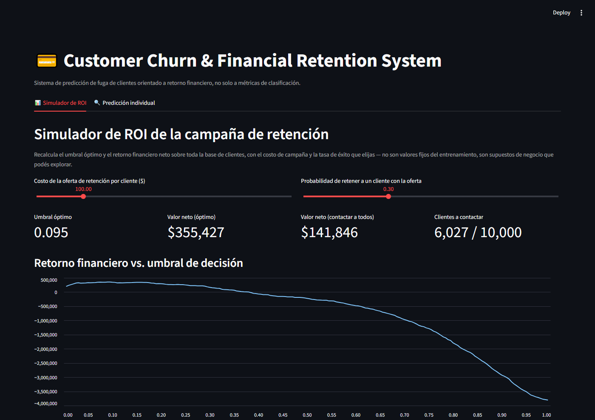
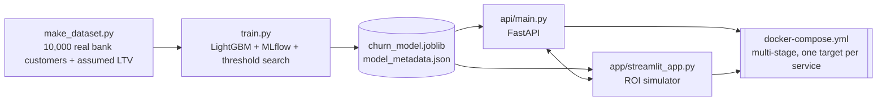
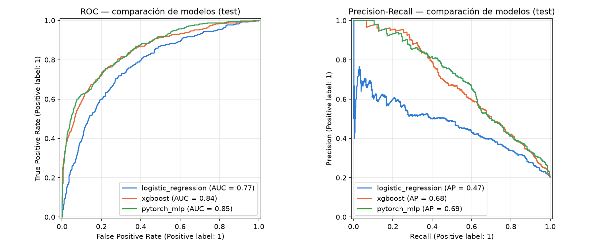
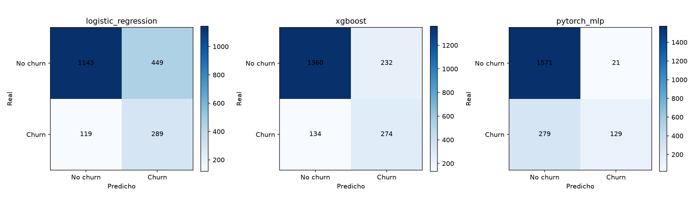
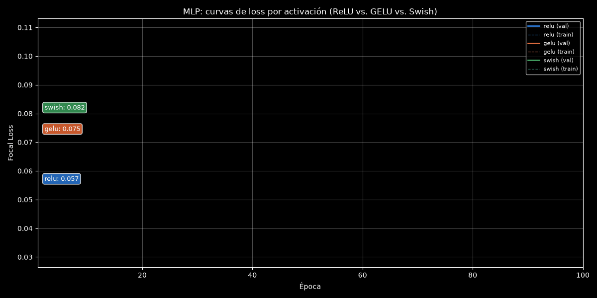
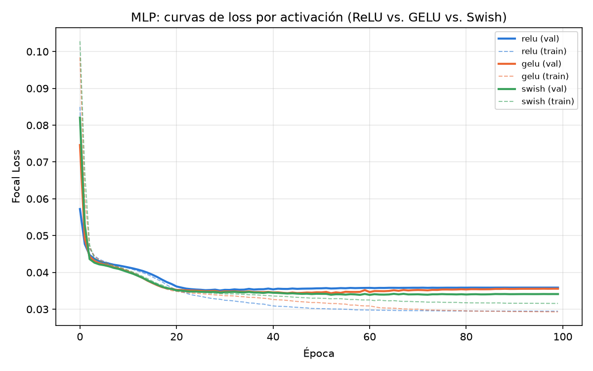
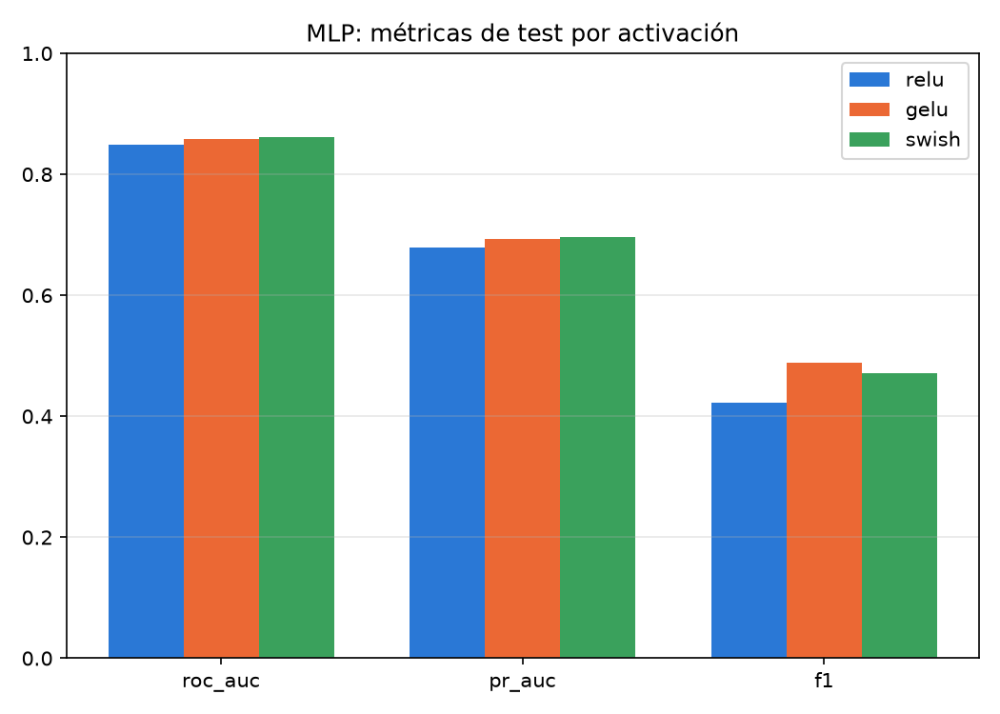

[ 🇺🇸 English ] | [ 🇨🇱 Leer en Español ](README.es.md)

# Customer Churn & Financial Retention Platform




An end-to-end customer churn prediction system for banking/retail, built around one central idea: **a churn model isn't worth its AUC, it's worth how much money the business stops losing when it's used to decide who to contact.**

## Business Impact & Key Performance Indicators

Trained on **10,000 real bank customers** (Kaggle "Bank Customer Churn", France / Germany / Spain, 20.4% churn) and evaluated on a 2,000-customer test holdout never seen during training or threshold selection. Value is measured against running no campaign at all (which loses $1.15M of churner LTV on the holdout):

| Strategy | LTV recovered, net of campaign cost | Customers contacted |
|---|---:|---:|
| Contact no one | $0 | 0% |
| Contact everyone (no model) | +$143,842 | 100% |
| **Model's threshold (0.24, chosen on validation)** | **+$189,930** | 41.7% |

The model recovers 32% more than an indiscriminate campaign while contacting fewer than half the customers. The offer cost ($100), retention rate (30%) and LTV are business assumptions, because the real dataset has churn but no revenue; they are documented in `src/data/make_dataset.py` and `src/models/train.py`.

Two findings from moving to real data:

- **The `Complain` column is a leak.** 2,034 of the 2,038 churners have a complaint, against 10 of the 7,962 who stayed: the complaint is recorded together with the exit. With it, LightGBM scores ROC-AUC 1.000; without it, **0.852**. It is kept in the data and excluded from the features, and `train.py` logs both numbers on every run.
- **The old financial objective double-counted.** It credited each contacted churner with 30% of their LTV but never charged the 70% who leave anyway, so each contact was worth 1.3 × LTV instead of 0.3 × LTV. That pushed the "optimal" threshold to 0.03 (contact 90% of customers). Fixed, the break-even is `p_churn = cost / (success_rate × LTV)`, about 0.12 for a typical customer, and the threshold lands at 0.24.

## Architecture



```
┌────────────────────────┐
│  make_dataset.py        │  10,000 real customers (Kaggle) + assumed LTV
└────────────┬─────────────┘
             │
             ▼
┌────────────────────────┐
│       train.py           │  LightGBM + 50/30/20 split + MLflow (tracking +
│  (MLflow: local SQLite)  │  registry) + financial-return threshold search
└────────────┬─────────────┘
             │
    ┌────────┴─────────┐
    │  data/processed/   │  churn_model.joblib + model_metadata.json
    └────────┬─────────┘
             │
   ┌─────────┴──────────┐
   ▼                     ▼
┌─────────────┐   ┌──────────────────┐
│  api/main.py │◄──┤ app/streamlit_app │  ROI simulator (recalculates the
│  (FastAPI)   │   │  .py              │  threshold live) + single prediction (via API)
└─────────────┘   └──────────────────┘
       │                    │
       └─────────┬──────────┘
                  ▼
        docker-compose.yml
   (multi-stage Dockerfile, one target per service)
```

`notebooks/02_LTV_Cost_Sensitive_Thresholding.ipynb` runs alongside this pipeline, consuming the trained model and `src/models/train.py` directly to dig into the holdout's LTV distribution and the gains curve (§Phase 4).

## The process (4 phases)

This project was built in phases, delivered and verified one at a time — not written all at once and assumed to work.

### Phase 1 — Data and modeling

`src/data/make_dataset.py` loads the real Kaggle dataset ([Bank Customer Churn](https://www.kaggle.com/datasets/radheshyamkollipara/bank-customer-churn), downloaded through the Kaggle API into the gitignored `data/raw/`) and maps it onto the project schema: credit score, country, gender, age, tenure, balance, products, card, activity, salary, satisfaction, card type, loyalty points, and the real exit flag. What the data does not have is revenue, so `monthly_fee_revenue` (15 + 8 × products + 0.0008 × balance) and the **projected LTV** (monthly revenue × expected future months, 48 if active and 18 if not) are explicit assumptions, used only for financial value and never as features. The original synthetic generator stays as a fallback with the same schema, for CI runs without Kaggle credentials.

`src/models/train.py` trains LightGBM on a stratified 50/30/20 split (train / val / test), tracks everything in MLflow (local SQLite, with a working Model Registry), and searches for the **decision threshold that maximizes net financial return** on validation, not the one that maximizes F1 or accuracy. The objective, per customer: an uncontacted churner loses their LTV; a contacted churner is retained with probability `success_rate`, otherwise lost; every contact costs the campaign price. Features exclude the customer ID, the LTV and revenue assumptions, and `num_complaints` (the leak above); the same run also trains a copy with the leak and logs its metrics, so the inflation stays visible.

Test metrics: ROC-AUC 0.852, PR-AUC 0.687. Threshold 0.24 on validation; recomputed on test (diagnostic only) it would be 0.19, and the curve is flat enough there that the difference costs $6,300 (0.7%).

### Phase 2 — API and UI

`src/api/main.py`: FastAPI + Pydantic v2, with `lifespan` (not the deprecated `on_event`) to load the model at startup. Before writing it I empirically verified a non-obvious LightGBM-in-production detail: categorical columns need to be cast to `dtype="category"` on every request (otherwise it fails with `"train and valid dataset categorical_feature do not match"`), but **not** replicating the exact category levels seen during training is fine — the booster keeps its own internal mapping (`pandas_categorical`) and applies it on its own. Endpoints: `/health`, `/model/info`, `/predict`, `/predict/batch`.

`src/app/streamlit_app.py`: two tabs. **ROI simulator**, with sliders for campaign cost and success rate that recalculate the optimal threshold and return live over the 10,000 customers. **Single prediction**, which calls the real API (doesn't load the model on its own) — genuine microservices architecture.

### Phase 3 — Containerization and tests

Multi-stage `Dockerfile`: `builder` (compiles with `build-essential`/`cmake`) → `runtime` (minimal shared base, with `libgomp1` installed — without that library, LightGBM fails to import on Debian slim with `libgomp.so.1: cannot open shared object file`, a real gotcha worth documenting) → `api` and `app` as final targets of the same Dockerfile, so the dependency definition isn't duplicated. `docker-compose.yml` brings up both services, mounts `data/` as a read-only volume (model artifacts aren't baked into the image), and uses a `curl`-free healthcheck (via the stdlib's `urllib`) so `app` waits for `api` to actually be ready.

`tests/`: `pytest` integration suite. `conftest.py` auto-generates the dataset and trains the model if they don't exist — verified for real by deleting every artifact and running `pytest tests/` from scratch (27/27 green), not just assumed. Without `data/raw/customers.csv` it tries the Kaggle API and falls back to the synthetic generator if there are no credentials.

**Verifying Docker without an available daemon.** This execution environment doesn't have Docker installed (neither Docker Desktop nor the CLI), so `docker compose up --build` itself couldn't literally be run. Rather than leaving it at "review it before a real deployment" and moving on, everything that *can* be validated without the daemon was validated, by replicating every Dockerfile stage outside the container:

1. **Clean `requirements.txt` install into an isolated venv** — replicates exactly what the `builder` stage does; no dependency conflicts.
2. **The exact `CMD` commands from the Dockerfile, run as-is** — `uvicorn src.api.main:app --host 0.0.0.0 --port 8000` and `streamlit run src/app/streamlit_app.py --server.address=0.0.0.0 --server.port=8501 --server.headless=true` both start and serve correctly in that isolated venv.
3. **The exact `healthcheck` command** from `docker-compose.yml` (`python -c "import urllib.request; urllib.request.urlopen(...)"`) run against the live API — responds `{"status":"ok","model_loaded":true}`.
4. **The full end-to-end pipeline** (`make_dataset.py` → `train.py` → serving with the real `CMD`) run in the isolated venv, with no artifacts inherited from another install.
5. **All the integration tests**, run from scratch against the freshly trained model.

This doesn't replace an actual `docker compose up --build` — the `COPY` paths, the multi-stage ordering, and the Docker engine itself still haven't literally run — but it covers exactly the code and commands that end up running inside the container, with far more confidence than "it's written carefully." **Recommendation**: before a real deployment, run `docker compose up --build` once on a machine with Docker installed as a final verification step.

### Phase 4 — LTV-weighted threshold analysis on holdout

`notebooks/02_LTV_Cost_Sensitive_Thresholding.ipynb` (executed end to end, zero errors) digs into three questions `train.py` doesn't show in detail:

1. **How is LTV distributed on the holdout?** The average real churner is worth $2,809, with a heavy tail (standard deviation ~$2,030, the same order as the mean); $1.15M of LTV is at risk in the holdout.
2. **Is the threshold an artifact of the split?** Validation picks 0.24; the optimum recomputed on the holdout (diagnostic only, never the operational decision) is 0.19. The value curve is flat near its peak, so the gap costs $6,300, 0.7% of the total.
3. **Gains curve and deciles.** Ranked by predicted risk, the top decile has 81% real churn and the bottom one 2.5%. Only the first five deciles pay for the offer; from the sixth onward an offer costs more than it recovers. At the operational threshold the campaign contacts 834 customers (41.7%) and recovers $189,930 net; the exact per-customer optimum contacts 960 and recovers $7,000 more.

### Phase 5 — Model comparison: logistic regression vs. XGBoost vs. PyTorch MLP

Before settling on LightGBM as the model actually served in production (Phases 1–4), `src/models/compare_models.py` answers the model-selection question a mature MLOps platform should be able to show evidence for: **how does it compare against a simpler baseline and against deep learning, on the exact same 50/30/20 split and features?** This script is purely additive — it doesn't touch `train.py`, the API, or the Streamlit app; it exists to document the comparison, not to replace what's already served.

Three complementary approaches:

| Approach | Library | Why it's here |
|---|---|---|
| Logistic regression (`class_weight="balanced"`) | scikit-learn | Interpretable baseline — auditable coefficients, minimum quality bar |
| Gradient-boosted trees | XGBoost | A second tree ensemble (different library than the one served in production) to check the result isn't an artifact of LightGBM specifically |
| MLP with custom Focal Loss | PyTorch | Deep learning with a loss designed for the churn class imbalance (~20% positive), plus a controlled comparison of ReLU vs. GELU vs. Swish activations on the same architecture |

**Test set results** (same holdout as Phases 1–4, at the default 0.5 threshold; a model-selection comparison, not the operational financial threshold):

| Model | ROC-AUC | PR-AUC | F1 |
|---|---:|---:|---:|
| Logistic regression | 0.772 | 0.466 | 0.504 |
| XGBoost | 0.845 | 0.675 | 0.600 |
| PyTorch MLP (Swish, Focal Loss) | 0.855 | 0.687 | 0.462 |
| LightGBM (served, from `train.py`) | 0.852 | 0.687 | — |

On real data the linear baseline falls clearly behind (ROC-AUC 0.77): the churn signal here is non-linear (age and number of products act in bands, not monotonically). The three non-linear models tie within 0.01 ROC-AUC, so LightGBM stays as the served model for its native categoricals and speed. The MLP's lower F1 at 0.5 comes from Focal Loss reshaping the probability scale, which is why the operational decision uses a financial threshold, not 0.5.

The MLP trains with early stopping on the validation loss (never test): at least 100 epochs, patience 20, ReduceLROnPlateau, and the best epoch's weights restored. A checkpoint is written every epoch (atomic write, with a fingerprint of data and configuration), and an interrupted run resumes from it; a test interrupts training mid-run and checks the resumed run matches a clean one. The best epochs were 30 (ReLU), 53 (GELU) and 61 (Swish) out of 100 run.

**Activation comparison** (validation set, same architecture and Focal Loss):

| Activation | ROC-AUC | PR-AUC | F1 |
|---|---:|---:|---:|
| ReLU | 0.848 | 0.679 | 0.423 |
| GELU | 0.858 | 0.693 | 0.489 |
| **Swish** | **0.861** | **0.696** | 0.471 |

Swish had the best validation PR-AUC and was selected for the test row. The spread between activations (0.017 PR-AUC) is smaller than the gap to the linear baseline.



The animated version below draws each activation's real loss curve frame by frame, with a floating label tracking its current value.





Metrics for all 3 model families and all 3 activations are persisted to `reports/model_comparison.duckdb` (tables `model_comparison_metrics` and `mlp_activation_comparison`) — a lightweight, SQL-queryable complement to the MLflow tracking/registry that `train.py` already uses for the production model.

```bash
python -m src.models.compare_models
```

## Project structure

```
customer-churn-mlops-platform/
├── data/
│   ├── raw/                        # customers.csv (generated, not versioned)
│   └── processed/                  # churn_model.joblib, model_metadata.json,
│                                    #   figures/threshold_vs_value.png (generated)
├── src/
│   ├── data/
│   │   └── make_dataset.py         # Loads the real Kaggle data (+ synthetic fallback) + LTV
│   ├── models/
│   │   ├── train.py                # LightGBM + MLflow + financial-return threshold
│   │   └── compare_models.py       # LR / XGBoost / PyTorch MLP comparison (Phase 5)
│   ├── api/
│   │   └── main.py                 # FastAPI: /predict, /predict/batch, /model/info
│   └── app/
│       └── streamlit_app.py        # ROI simulator + single prediction
├── notebooks/
│   └── 02_LTV_Cost_Sensitive_Thresholding.ipynb  # LTV on holdout + gains curve
├── reports/
│   ├── figures/                    # roc_pr_comparison.png, confusion_matrices.png,
│   │                                #   mlp_activation_loss_curves.png, mlp_activation_comparison.png
│   └── model_comparison.duckdb     # comparison metrics (generated, not versioned)
├── tests/
│   ├── conftest.py                 # Auto-bootstraps dataset + model for CI
│   ├── test_data_and_training.py
│   ├── test_api.py
│   └── test_model_comparison.py
├── docs/
│   └── streamlit_preview.png
├── Dockerfile                      # Multi-stage: builder -> runtime -> api / app
├── docker-compose.yml
├── requirements.txt
├── LICENSE
├── README.md
└── README.es.md
```

## Installation

```bash
python -m venv .venv
source .venv/bin/activate      # On Windows: .venv\Scripts\activate
pip install -r requirements.txt
```

## Usage

```bash
# 1. Build the dataset (downloads the real Kaggle data; needs ~/.kaggle/kaggle.json)
python -m src.data.make_dataset

# 2. Train (LightGBM + MLflow + financial threshold optimization)
python -m src.models.train

# 3a. Bring up the API
uvicorn src.api.main:app --reload

# 3b. Bring up the UI (in another terminal; waits for the API to be running)
streamlit run src/app/streamlit_app.py

# View the experiments tracked in MLflow
mlflow ui --backend-store-uri sqlite:///mlflow.db

# Integration tests (auto-generates dataset/model if missing)
pytest tests/ -v

# Optional: compare LR / XGBoost / PyTorch MLP against the production LightGBM model
python -m src.models.compare_models
```

### Analysis notebook (optional, not part of the Docker image)

```bash
pip install jupyter ipykernel nbconvert
jupyter nbconvert --to notebook --execute --inplace notebooks/02_LTV_Cost_Sensitive_Thresholding.ipynb
```

Jupyter is deliberately not added to `requirements.txt`: that file is what the `Dockerfile` installs inside the `api`/`app` images, and an analysis notebook has no business being inside a production service container.

## Docker deployment

```bash
# Builds both images (api, app) and brings up the two services
docker compose up --build

# API:       http://localhost:8000/docs  (interactive Swagger UI)
# Streamlit: http://localhost:8501
```

What `docker-compose.yml` does exactly:

- **`api`** builds from the Dockerfile's `api` target (image `churn-api:latest`), exposes port `8000`, mounts `./data` as a read-only volume (`:ro`) — the trained model is read from the host, not baked into the image — and exposes a `healthcheck` that hits `/health` every 10s (with a 15s `start_period`) using the stdlib's `urllib`, without depending on `curl` being installed in the minimal image.
- **`app`** builds from the `app` target (image `churn-streamlit:latest`), exposes port `8501`, also mounts `./data` read-only, receives `API_URL=http://api:8000` as an environment variable to talk to the API by its Docker Compose service name (not `localhost`), and has `depends_on: api: condition: service_healthy` — it won't start until `api`'s healthcheck is green.

Useful commands once it's up:

```bash
docker compose ps                 # status of both services
docker compose logs -f api        # live API logs
curl http://localhost:8000/health # {"status":"ok","model_loaded":true}
docker compose down               # stops and removes the containers (not mounted volumes)
```

**Prerequisite**: `data/processed/churn_model.joblib` and `model_metadata.json` must exist on the host before bringing up the containers (run `python -m src.data.make_dataset` and `python -m src.models.train` first) — the containers *serve* the trained model, they don't train it; the read-only volume is deliberate, it separates the model artifact's lifecycle from the application code's lifecycle.

## API reference

| Method | Path | Description |
|---|---|---|
| `GET` | `/health` | Service status and whether the model is loaded |
| `GET` | `/model/info` | Active model metadata: optimal threshold, AUC, business assumptions |
| `POST` | `/predict` | Prediction for one customer; if `ltv` is sent, adds the expected financial value |
| `POST` | `/predict/batch` | Prediction for a list of customers |

Example:

```bash
curl -X POST http://localhost:8000/predict -H "Content-Type: application/json" -d '{
  "credit_score": 550, "geography": "Germany", "gender": "Female", "age": 52,
  "tenure_years": 1, "balance": 110000, "num_products": 1, "has_credit_card": false,
  "is_active_member": false, "estimated_salary": 40000, "satisfaction_score": 2,
  "card_type": "SILVER", "points_earned": 400, "ltv": 2500
}'
# {"churn_probability":0.9742,"optimal_threshold":0.24,"recommended_action":"contact","expected_financial_value":630.66}
```

`expected_financial_value` is the expected value of contacting this customer versus not contacting them: `p_churn × success_rate × LTV − cost`.

## Tech stack

| Tool | Role |
|---|---|
| **LightGBM** | Churn classification model (native categoricals) |
| **MLflow** | Experiment tracking, business metrics, and Model Registry (local SQLite) |
| **FastAPI + Pydantic v2** | Inference API with strict schema validation |
| **Streamlit** | ROI simulator UI and single prediction |
| **Docker** | Multi-stage image, one `target` per service |
| **pytest** | Integration suite (data, financial logic, real API) |
| **Jupyter / nbconvert** | `notebooks/02_LTV_Cost_Sensitive_Thresholding.ipynb`, executed end to end and committed with real outputs (§Phase 4) |
| **pandas / numpy / scikit-learn** | Data preparation and modeling utilities |
| **XGBoost** | Second gradient-boosting family for model comparison (§Phase 5) |
| **PyTorch** | MLP with custom Focal Loss + ReLU/GELU/Swish activation comparison (§Phase 5) |
| **DuckDB** | Local, SQL-queryable persistence of comparison metrics (§Phase 5) |

## Known limitations

- The customers and the churn flag are real, but revenue and LTV are not: the dataset has no revenue column, so both are documented assumptions. The financial numbers show how the decision works under those assumptions, not the bank's actual returns.
- The dataset is a single anonymous snapshot with no dates, so the split is stratified, not temporal; a production system would validate on later months.
- `Complain` is excluded as a leak; satisfaction score and loyalty points could carry the same problem in a weaker form, since the dataset does not say when they were recorded.
- The optimal threshold depends on `campaign_cost` and `retention_success_rate`, which are adjustable business assumptions (that's why the ROI simulator exists: to explore what happens if they change).
- Threshold selection on a moderately sized validation set is sensitive to LTV's heavy tail — a handful of high-value customers can move the total by tens of thousands of dollars. §Phase 4 measures this sensitivity directly (comparing the validation threshold against the one recalculated on holdout) instead of just warning about it, and finds a small, cheap gap (0.24 vs. 0.19, 0.7% of value); a production system should keep monitoring this stability against real data.
- Docker verification in this environment was by equivalence (isolated venv + the Dockerfile's exact commands), not a literal `docker compose up --build` run — see §Phase 3 for the exact detail of what was validated and what still needs confirming on a machine with Docker.

## Author

**Pablo Reyes** — [github.com/Rxyxs](https://github.com/Rxyxs)

Code: MIT — see [LICENSE](LICENSE).
